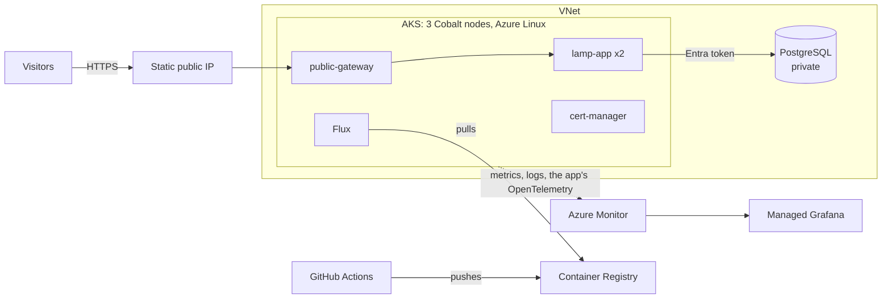

# ☁️ Azure Infrastructure - Lamp Web App

The lamp runs on Azure Kubernetes Service. Everything here is Bicep, deployed with `azd provision`, and sized to fit inside a $150/month credit.

## 🏛️ What gets deployed



| Module | What it creates |
| --- | --- |
| `network/network.bicep` | Virtual network, a subnet delegated to PostgreSQL, its private DNS zone, and the static public IP (with a DNS name) the site is served on |
| `compute/aks.bicep` | The cluster, its role assignments, workload identity federation, and the Flux extension and configuration |
| `monitor/monitoring.bicep` | Managed Prometheus for metrics, Container Insights for logs, and the data collection rule the OpenTelemetry collector writes the app's telemetry to |
| `monitor/grafana.bicep` | Azure Managed Grafana (Standard) over the Azure Monitor and Log Analytics workspaces |
| Azure Verified Modules, called from `main.bicep` | `avm/res/managed-identity/user-assigned-identity` (four times: the control plane, the lamp pods, the OpenTelemetry collector, and Flux each get their own identity) `avm/res/container-registry/registry` (for the app image and the manifest bundle) and `avm/res/db-for-postgre-sql/flexible-server` (private, Entra sign-in only). Their defaults lean towards production (Premium registry, zone-redundant database with geo backups and threat protection), so the cost choices are written out in the calls |

**The cluster**

- Kubernetes 1.36 (the newest generally available), patch releases and node images applied automatically on Sundays
- Three `Standard_D2pds_v6` nodes: Arm64 Cobalt 100 processors, 2 vCPU and 8 GB each, one per availability zone
- Azure Linux 3 with ephemeral OS disks (the OS lives on the VM's own NVMe disk)
- Azure CNI Overlay with the Cilium dataplane and network policy
- Entra ID sign-in with Azure RBAC; local accounts are disabled

**No passwords anywhere.** The lamp pods sign in to PostgreSQL with Microsoft Entra Workload ID. Flux and the nodes pull from the registry with managed identities. CI pushes with GitHub's OIDC federation. There is no Key Vault because there is nothing to put in one.

## 🧭 Where things are in the cluster

| Looking for | Namespace | Name | Defined in |
| --- | --- | --- | --- |
| The application's pods | `lamp` | `lamp-app-…` | `k8s/app/lamp-app.yaml` |
| The gateway's proxy pods, which carry the traffic | `envoy-gateway-system` | `public-gateway-…` | `k8s/app/public-gateway.yaml` |
| The Gateway object and its TLS certificate | `gateway` | `public-gateway`, `lamp-tls` | `k8s/app/public-gateway.yaml` |
| The gateway controller, which carries no traffic | `envoy-gateway-system` | `envoy-gateway-…` | `k8s/infrastructure/gateway-controller.yaml` |
| cert-manager | `cert-manager` | `cert-manager-…` | `k8s/infrastructure/cert-manager.yaml` |
| Flux | `flux-system` | `source-controller-…` and friends | The AKS extension, in `infra/modules/compute/aks.bicep` |

## 🔄 How a change reaches the cluster

1. A pull request is opened. The **Tests** job runs, and with it Flux's validator over `k8s/`: every manifest is checked against its schema, with the `${PLACEHOLDERS}` filled in.
2. It merges to `main`. The **Publish** job builds the Arm64 image and pushes it to the registry, tagged with the commit.
3. The same job pushes the `k8s/` folder as an OCI artifact, with that image tag written in. If the commit is still the newest on `main`, the `latest` tag moves to it.
4. Flux, inside the cluster, sees the new artifact within a minute and applies it. Five Flux Kustomizations apply it: `k8s/infrastructure` (the gateway controller and cert-manager), `k8s/namespaces` and `k8s/monitoring` (what Managed Prometheus collects) first, then `k8s/observability` (the OpenTelemetry collector; after the namespaces), then `k8s/app` (the public gateway and the application; after `infrastructure` and `observability`). The collector comes before the app so the app's first spans and metrics have somewhere to go.

Nothing outside the cluster ever holds credentials for it. Values that differ per deployment (host name, identity, database address) are handed to Flux by Bicep as `manifestValues` and replace the `${PLACEHOLDERS}` in `k8s/app`. A placeholder that gets no value stops the rollout.

To undo a change, revert it on `main`. The revert is published like any other commit.

### Where the truth is

The cluster reads the registry, and only CI on `main` writes to it. Flux calls this [Gitless GitOps](https://fluxcd.io/flux/concepts/#gitless-gitops): changes are made in Git, and the registry is what the cluster follows.

| What | Decided by | How to see what is running |
| --- | --- | --- |
| The manifests and the app image | The newest commit on `main` | The command below. The bundle records its commit, and the image tag is that commit |
| Envoy Gateway and cert-manager versions | The newest 1.x release of each chart. Git holds the range, not the version | `kubectl get helmreleases -n flux-system` |
| Host name, identities, database address | `manifestValues` in `infra/main.bicep`, as of the last run of the Deploy workflow | The cluster's GitOps page in the Azure portal |
| The version of Flux | The AKS extension, which upgrades itself | The cluster's Extensions + applications page in the Azure portal |

```bash
kubectl get ocirepositories -n flux-system -o custom-columns='NAME:.metadata.name,BUILT_FROM:.status.artifact.metadata.org\.opencontainers\.image\.revision'
```

A change made with `kubectl` does not last. Flux puts back what the bundle says: within ten minutes for the manifests, within thirty for the two Helm releases.

## 💰 What it costs

Prices are Central US, October 2026 (retail prices API).

| Item | Monthly |
| --- | --- |
| Three nodes, 8 hours a day ($0.104/hour each) | $76 |
| Load balancer | $18 |
| PostgreSQL B1ms + 32 GB | $18 |
| Two public IPs (site, outbound) | $7 |
| Container registry (Basic) | $5 |
| Prometheus ingestion (estimate) | $5 |
| Azure Managed Grafana (Standard, $0.042/hour while it exists, plus $6 for each user) | $16 |
| Logs (capped at 0.2 GB a day; the first 5 GB a month are free) | $0-2 |
| **Total** | **about $145** |

- **Nothing stops the cluster for you.** Deploy it to test and run **Destroy Azure Infrastructure** when you are done: once the resource group is gone nothing is billed. Left up, the three nodes alone cost about $0.31 an hour ($228 a month), and the rest of the table about $0.12 an hour. The table above is that stack up 8 hours a day for a month.
- **Mind the spending limit.** On a credit subscription, reaching $150 switches everything off until the next month. The table leaves about $5 of it, so a month of testing sessions fits and an environment left up does not.
- **One charge to check on your first bill.** Azure's price list gained an AKS "free tier infrastructure" meter of $0.05/hour dated 2026-10-01 that the documentation does not describe. If it applies it adds up to $36 a month.
- **Spot nodes are not an option here.** Visual Studio (MSDN) subscriptions cannot create spot VMs. On a pay-as-you-go subscription the same node costs $0.017/hour as spot.

## 🚀 Deploying

**Once, in the GitHub repository settings**

- Secrets `AZURE_CLIENT_ID`, `AZURE_TENANT_ID`, `AZURE_SUBSCRIPTION_ID`: an app registration with a federated credential for this repository's `main` branch, holding Contributor and User Access Administrator on the subscription.
- Secret `AKS_ADMIN_OBJECT_ID`: your Entra object ID. Without it nobody is granted `kubectl` access. It is an identifier, not a credential; it is a secret so that the run logs, which are public, mask it. To set it without displaying it: `az ad signed-in-user show --query id -o tsv | gh secret set AKS_ADMIN_OBJECT_ID`

**Then** run the **Deploy Azure Infrastructure** workflow. It provisions everything (about 20 minutes the first time, 10 after that) and starts the Tests workflow, whose Publish job gives the new cluster something to run. The site's address is the `lampUrl` output.

To deploy from your own machine instead: `azd env set AKS_ADMIN_OBJECT_ID <id>`, `azd provision`, then run the Tests workflow from the Actions tab.

The PostgreSQL step sometimes fails claiming the virtual network or its subnet "doesn't exist", moments after Azure has created them. Running the deployment again gets past it, and the workflow retries by itself.

**Region.** `centralus` is the default because this credit subscription is refused PostgreSQL flexible servers in several regions: all of them in East US 2, East US, West US 2 and South Central US (checked 2026-10-06), and Burstable ones in West US 3, which worked on 2026-10-11 and was refused on 2026-10-25 (`SkuNotAvailable`; a General Purpose server was accepted there). Measured on 2026-10-25 by creating `Standard_B1ms` servers (PostgreSQL 18, no VNet): refused in West US 3 whatever the zone, version 17 or 18, and for `Standard_B2s`; accepted in Central US and North Central US. `az postgres flexible-server list-skus -l <region>` listed West US 3's Burstable sizes as available throughout, so it does not show this: only creating a server does. Central US costs about 13% more for nodes than West US 3 did, and its `Standard_D2pds_v6` nodes have zones 1, 2 and 3; North Central US lists no zones for them. An environment already deployed in another region should be removed with **Destroy Azure Infrastructure** before the first deploy here; whether Azure would accept the existing group in a new region was not tested.

## 🧰 Day to day

```bash
# kubectl access. Upgrade kubelogin first (brew upgrade kubelogin): releases from 2022
# empty your existing ~/.kube/config when they convert a kubeconfig.
az aks get-credentials --resource-group rg-lamp-web-app-dev --name <cluster>
kubelogin convert-kubeconfig -l azurecli

# What is Flux doing?
kubectl get kustomizations,ocirepositories,helmreleases -n flux-system

# The app
kubectl -n lamp get pods -o wide
kubectl -n lamp logs -l app=lamp-app -f

# A shell in a pod. The image is distroless and has none, so `kubectl exec` has nothing to run;
# attach a debug container instead (an ephemeral container, stable since Kubernetes 1.25:
# https://kubernetes.io/docs/tasks/debug/debug-application/debug-running-pod/). The namespace
# enforces the restricted profile and the pod must run as non-root, but busybox runs as root, so
# --custom gives the debug container the app's user. Tried on this cluster on 2026-10-25: it sees the
# app's processes and can reach it on localhost, but not its files (/proc/1/root is denied), and
# without --custom the container never starts. Ephemeral containers cannot be removed from a pod.
echo '{"securityContext":{"runAsUser":10001,"runAsGroup":10001,"runAsNonRoot":true}}' > /tmp/debug.json
kubectl -n lamp debug -it <pod> --image=busybox:stable --target=lamp-app --profile=restricted --custom=/tmp/debug.json

# The gateway: its status and address, then the proxies behind it
kubectl -n gateway get gateway public-gateway
kubectl -n envoy-gateway-system get pods -l gateway.envoyproxy.io/owning-gateway-name=public-gateway

# Pause the cluster between sessions without destroying it (the site is offline meanwhile)
az aks start --resource-group rg-lamp-web-app-dev --name <cluster>
az aks stop  --resource-group rg-lamp-web-app-dev --name <cluster>
```

**One place to look: Azure Managed Grafana.** The address is the deployment's `grafanaUrl` output, next to `lampUrl` (or the Grafana resource's overview in the portal). Sign in with your Entra account: the deploy gives `AKS_ADMIN_OBJECT_ID` the Grafana Admin role. Its data sources are the Azure Monitor workspace (PromQL: cluster and app metrics) and Log Analytics (KQL: container logs, and the app's spans in `OTelSpans`).

| Dashboard (in `infra/dashboards`) | The question it answers |
| --- | --- |
| Kubernetes / Cluster health (overview) | Is the cluster healthy, and what is running out? Nodes Ready, pods not running, restarts, OOM kills, Deployments below their replicas, PDBs that block a drain, CPU and memory requested against allocatable, USE-method utilisation and saturation per node |
| Kubernetes / DNS (CoreDNS) | Is cluster DNS answering? Rate, SERVFAIL and REFUSED ratio, latency percentiles, cache hit ratio, upstream latency |
| Kubernetes / Network | Is the network losing packets? Node and pod throughput, drops, interface errors, TCP retransmits, conntrack. Built from node-exporter and cAdvisor, **not Cilium's own metrics** (see below) |
| Kubernetes / Control plane | Is the AKS API server and etcd healthy? Request rate, errors, average latency, in-flight requests, etcd leader and size |
| Kubernetes / Edge (Envoy Gateway) | What do visitors' requests look like before they reach the app? Rate, response classes, latency, connections, upstream failures |
| Kubernetes / GitOps and certificates | Is Flux applying what CI published, and is a certificate about to expire? |
| Lamp API (FastAPI OpenTelemetry) | The application itself: rate, status codes, latency per route, errors, requests in flight |

They link to Grafana's built-in Kubernetes dashboards (Compute Resources, Node Exporter, Kubelet) instead of repeating them. Those depend on recording rules; see "What is collected" below.

**What is collected.** The Managed Prometheus add-on reads `k8s/monitoring/ama-metrics-settings.yaml` (Microsoft's schema v2 settings ConfigMap): CoreDNS is switched on (off by default), the Windows, GPU, storage and Cilium-observability targets are off, and the minimal ingestion profile stays on with a keep list per target for the extra metrics these dashboards and alerts use. Three `PodMonitor`s (the managed add-on's own CRD) scrape the Envoy proxies, cert-manager and the Flux controllers, keeping only the series the dashboards read. The API server and etcd come from AKS's control plane metrics (`azureMonitorProfile.metrics.controlPlane`, GA in the `2026-06-01` API). **Ingestion volume, and so its cost, has not been measured**: it is the first thing to look at after a deploy (the Azure Monitor workspace's metrics, "Events Per Minute Ingested").

**Cilium and Hubble metrics are not here, on purpose.** Microsoft's feature table puts Container Network Observability (the Cilium agent and Hubble metrics: drops by reason, policy verdicts, per-pod flows and DNS) behind Advanced Container Networking Services, which is billed at $0.025 per node-hour: about $18 a month for these three nodes at 8 hours a day, which this budget does not have ([Azure CNI Powered by Cilium](https://learn.microsoft.com/azure/aks/azure-cni-powered-by-cilium#frequently-asked-questions), [container network metrics](https://learn.microsoft.com/azure/aks/container-network-observability-metrics#pricing)). Whether the Cilium agent's own metrics endpoint can be scraped without it was not tried (AKS documents that only label exclusion in `cilium-config` is supported).

**Alerts.** `infra/modules/monitor/alerts.bicep` is one Prometheus rule group on the workspace (19 rules, evaluated every minute by Azure): a node not Ready, crash loops, pods that cannot be scheduled, Deployments below their replicas, OOM kills, memory and disk, CPU overcommit, CoreDNS down, slow or failing, API server errors, certificates close to expiry or not Ready, Flux errors, Envoy down or returning 5xx, and the lamp API's own 5xx and missing replicas. They mail the address in the repository secret `ALERT_EMAIL` (like `AKS_ADMIN_OBJECT_ID`: an identifier, set as a secret because this repository's logs are public); without it the rules still fire and show in the portal under **Alerts**. Azure refuses a rule that waits 0 minutes (`for: PT0M`): the shortest is one. **Not yet seen firing**: they were deployed to a scratch workspace and their expressions parse with Prometheus's own parser, but no rule has been seen firing and clearing on a cluster, and whether an email arrives is untested.

**Checks in CI.** `.github/scripts/check-promql.py` runs every expression in the dashboards and the alert rules through Prometheus 3's `promtool`, so a typo fails on the pull request. It proves they parse, not that the metrics exist: that is checked against the live workspace.

**The app's own telemetry.** FastAPI 0.143 emits OpenTelemetry natively ([its docs](https://fastapi.tiangolo.com/advanced/opentelemetry/)). `FASTAPI_OTEL_AUTO_CONFIGURE=true` and the `OTEL_*` settings in `k8s/app/lamp-app.yaml` send it to the collector in `k8s/observability` (`otel-gateway`, two replicas), which batches it and posts it to a data collection rule with its own workload identity (`Monitoring Metrics Publisher` on that rule and nothing else). Metrics go to the Azure Monitor workspace, spans and logs to Log Analytics. The source of the dashboard is `infra/dashboards/lamp-api.json`. A push to `main` that changes anything under `infra/dashboards/` runs the **Deploy dashboard** workflow, which imports the JSON into Grafana through its API (Grafana dashboards are not Azure resources) and not the cluster, so a panel change does not wait for the full Deploy; the Deploy workflow starts it too once the infrastructure exists. `src/store.py` adds a span per database call (`store.toggle`, `store.snapshot`, `store.pulse`, `store.ping`, `store.leave`) under the request's own, so a slow query shows as one: in Log Analytics, `OTelSpans | where ServiceName == "lamp-app" | where Name startswith "store."`.

**What was tried before this was built** (2026-10-25, a scratch resource group with the final rule, the pinned collector image and the app image in Docker, and a Grafana deployed from `grafana.bicep`): Azure accepts the data collection rule without any Application Insights reference; spans arrive in `OTelSpans` and `OTelResources`; metrics keep their dots and native-histogram shape; all 20 panel queries run; Grafana's workspace integration creates the Prometheus data source and its identity reads it; `az grafana dashboard create --overwrite` imports the dashboard. A span row bills about 635 bytes, so the 0.2 GB-a-day cap on the log workspace is about 315,000 spans a day, shared with the container logs. The Lamp API dashboard shows a "conflicting counter resets during histogram aggregation" warning on the panels that sum the delta histograms; the values are right (they add up to the requests sent).

**What has not been seen on the cluster until a deploy shows it:** the collector's `azure_auth` extension signing in with the pod's workload identity and refreshing its token (the rehearsal used a one-hour token and lost data when it expired), the NetworkPolicies on Cilium, and Flux's `$$` escape for the collector's own `${env:...}` settings (verified with `flux build`, not on the cluster).

In that workspace the metric names and labels keep their dots (`{"http.server.request.duration"}`), they are native histograms, and each export interval is stored as its own sample, so the dashboard sums them with `sum_over_time` instead of using `rate()`. Measured on this cluster, not documented by Microsoft: the per-interval samples added up to the number of traced requests (60), while `increase()` gave 18.

`/livez` probes are not recorded. Every open event stream counts as one long request that ended in `ConnectionError` when the page closed, so `/api/v1/lamp/events` shows as errors: filter `error.type="ConnectionError"` out of an error panel, as the dashboard's "Errors by route" does, and leave the route in. A stream the server itself ends (a pod stopping: uvicorn cancels open streams before the app's shutdown hook runs, so that hook cannot close them) ends as `asyncio.exceptions.CancelledError` instead, and that stays visible. Every rollout that stops a pod with open streams therefore shows one such error per stream: that is the deploy, not a fault. Seen locally with SIGTERM against a running stream; not yet seen on AKS, including whether the sample reaches the workspace while the pod is terminating.

**Logs.** In the portal, open the cluster and choose **Monitoring > Logs**, then query with KQL:

```kusto
ContainerLogV2
| where PodNamespace == "lamp"
| project TimeGenerated, PodName, LogMessage
| order by TimeGenerated desc
```

Redeploying the Bicep needs the cluster running; the workflow starts it if you stopped it.

**What a start looks like.** Stopping the cluster discards its nodes, so starting it (or a fresh deploy) boots three new ones and every pod is scheduled again at once. The site answers 5 to 14 minutes after the start. Most of the spread is workload identity: pods that use it cannot be created until AKS's identity webhook is running (it fails closed, by design), and Kubernetes retries at growing intervals. Two things in `k8s/app` exist because of the start: the `serving` PriorityClass (the site's pods get onto a node ahead of the tooling) and `minDomains` on the spread constraints (the second replica waits for a second node instead of joining the first).

## ⏪ Rolling back

**The app and its manifests** (the usual case). Every publish leaves a bundle in the registry tagged with its commit, and the image it points at; the cluster follows the tag `latest`. Run **Actions > Roll back the app** with the full SHA of the last good commit on `main`. It checks that the bundle and the image exist, moves `latest` to that bundle, and waits for Flux to report it applied. The registry is Basic SKU, which has no retention policy, so old bundles stay until someone deletes them.

It does not change `main`: the next merge publishes again and moves `latest` forward. Revert the bad commit in Git too, or that merge puts it back.

**The infrastructure.** There is no automated rollback. Revert the commit and run **Deploy Azure Infrastructure** (about ten minutes). An infrastructure rollback has not been tried.

Tested on the live registry: the lookups find an existing commit's bundle and image and fail for an unknown one, and `flux tag artifact` pointed a scratch tag at an older bundle without moving `latest` (the scratch tag was then removed). The workflow itself has not run.

## ⚖️ Checked against Microsoft's guidance

The setup was compared with Microsoft's AKS best-practice articles ([reliability](https://learn.microsoft.com/azure/aks/best-practices-app-cluster-reliability), [cluster security](https://learn.microsoft.com/azure/aks/operator-best-practices-cluster-security), [networking](https://learn.microsoft.com/azure/aks/operator-best-practices-network), [workload identity](https://learn.microsoft.com/azure/aks/workload-identity-overview)).

**Followed**

- Availability zones; ephemeral OS disks; no B-series VMs; Standard load balancer; Azure CNI Overlay
- Entra ID with Kubernetes RBAC; automatic Kubernetes and node image upgrades inside a maintenance window
- Workload identity through the service-account annotation and pod label, with no fixed credentials anywhere
- CPU and memory requests and limits on every pod defined here; two replicas; PodDisruptionBudgets; a `preStop` hook; readiness, liveness and startup probes; topology spread constraints
- Pods run as non-root with no privilege escalation; network policies restrict traffic and block the node metadata endpoint
- Image tags are commit hashes, never `latest`; base images are kept current by Dependabot
- Managed Prometheus and Container Insights; the app's OpenTelemetry goes through a collector that signs in with its own workload identity, to the data collection rule Microsoft documents for collectors
- Flux with its default multi-tenancy lockdown

**API versions.** Each resource uses the newest GA version that both Azure Resource Manager accepts (`az deployment sub validate` is the authority: it rejects versions the resource provider does not have) and the Bicep type data covers, so the compiler can still check the properties. Where the newest GA version has no type data yet (Managed Grafana, `2026-09-01`), the newest one that has it is used (`2025-08-01`), so the compiler can still check it. No resource uses a preview version.

**Not followed, and why**

| Microsoft's guidance | Here | Why |
| --- | --- | --- |
| Standard tier, for the uptime SLA | Free tier | $73/month |
| A dedicated system node pool of two or more nodes, plus a user pool | One pool of three nodes, shared | Separate pools need at least four nodes (two for the system pool, two so the app's replicas sit on different ones); the budget covers three |
| Cluster autoscaler | A fixed node count | It makes the bill predictable under a spending limit. On two nodes it also kept adding and removing a third |
| The application routing add-on's Gateway API implementation | Envoy Gateway, installed by Flux | Measured on a real cluster, the managed one reserves 1 vCPU and 4 GB for its control plane (this one: 25m). The CLI still labels it preview, and its proxies are rejected by the `restricted` pod security profile. `k8s/app` is plain Gateway API, so switching is a change of `gatewayClassName` |
| Defender for Containers, and image vulnerability scanning in the registry | Neither. CI scans the image instead | Defender is billed per vCPU. CI runs Trivy on the built image and fails on a finding that has a fix, and Copacetic patches what it can (`.github/actions/harden-image`). Nothing rescans an image once it is in the registry |
| Azure Policy add-on | Pod Security Admission labels on the namespaces | It adds controllers of its own to nodes that are already nearly full after a start; the built-in admission control enforces the pod rules that matter here |
| A web application firewall in front of ingress | None | Application Gateway for Containers and Front Door start at tens of dollars a month |
| LocalDNS on node pools | Cluster DNS only | Not tried; it changes where pods send DNS queries, which the egress policy would have to allow |
| Least privilege for the database | The app is the server's Entra administrator | A lesser role takes SQL run from inside the network, which Bicep cannot do |
| Private API server or authorized IP ranges | Public endpoint, Entra ID only | CI and your laptop reach it from changing addresses |
| Control plane diagnostic settings (kube-audit and the other logs), and Defender for Containers | Neither | Not wanted for this environment: the log volume and per-vCPU price are not worth it for a practice cluster |
| A NAT gateway for outbound traffic | The load balancer | $32/month |
| Microsoft's recommended path for AKS applications is its OTLP application monitoring, through Application Insights | A collector in the cluster, writing to the data collection rule directly | That path is a preview (Microsoft: not for production), needs an Application Insights resource that creates a second pair of workspaces in a resource group of its own, and its agent takes about 0.5 vCPU and 250 MiB. Microsoft documents the collector path too ("Option 2: manual resource orchestration", and the Application Insights resource is optional), but the collector's `azure_auth` extension is beta and supported by the OpenTelemetry community, not Microsoft |
| Azure Managed Grafana costs about $16 a month at 8 hours a day | Used anyway | It replaces the portal's preview "Dashboards with Grafana", which cost nothing extra. Microsoft deprecated the Essential tier and no new instance can have it, so Standard is the only choice |

## 🔁 Checked against Flux's and Microsoft's GitOps guidance

Compared with Flux's recommended settings for [Kustomizations](https://fluxcd.io/flux/components/kustomize/kustomizations/#recommended-settings) and [Helm releases](https://fluxcd.io/flux/components/helm/helmreleases/#recommended-settings), its [OCI workflow](https://fluxcd.io/flux/cheatsheets/oci-artifacts/) and [security best practices](https://fluxcd.io/flux/security/best-practices/), and with Microsoft's [GitOps with Flux v2](https://learn.microsoft.com/azure/azure-arc/kubernetes/conceptual-gitops-flux2), [its CI/CD workflow](https://learn.microsoft.com/azure/azure-arc/kubernetes/conceptual-gitops-flux2-ci-cd) and [GitOps for AKS](https://learn.microsoft.com/azure/architecture/example-scenario/gitops-aks/gitops-blueprint-aks).

**Followed**

- Flux runs as the AKS extension, which keeps it current, and reads the registry with its own workload identity
- The extension's multi-tenancy lockdown stays on, and every Flux object lives in the configuration's namespace
- Add-ons are applied, and healthy, before the app. Both Kustomizations prune what was removed, wait for health, and retry two minutes after a failure
- The bundle is published with the commit it was built from
- Helm charts come from OCI registries through `OCIRepository`, with drift detection on. One field is exempt: the namespace selector on cert-manager's webhook, which [AKS extends by itself](https://learn.microsoft.com/azure/aks/faq#can-admission-controller-webhooks-affect-kube-system-and-internal-aks-namespaces-) to keep webhooks away from its own namespaces
- Manifests are validated on every pull request, with Flux's own validator (`flux schema`, which is still in preview)
- Strict substitution is on, so a placeholder with no value fails instead of becoming an empty string
- Only stable Flux API versions are used, and nothing secret is in the manifests or the bundle
- Manifests cannot pull in remote bases: the extension starts kustomize-controller with `--no-remote-bases`, and nothing in `k8s/` uses one

**Not followed, and why**

| Guidance | Here | Why |
| --- | --- | --- |
| Microsoft: a separate GitOps repository, where each deployment arrives as a reviewed pull request of rendered manifests | One repository. CI renders the manifests and publishes them to the registry | This is Flux's OCI workflow, which the AKS extension supports but Microsoft's workflow article does not describe. With one person and one environment, the pull request to `main` is the review |
| Flux: sign the bundle, and have Flux verify the signature before applying it | Unsigned | Whoever can push to the registry can deploy to the cluster; that is CI's identity and the subscription's owner. Signing without a stored key is the kind Flux still calls experimental |
| Flux and Microsoft: report each rollout back, as alerts or as a status on the commit | The compliance state in the Azure portal | Either needs a token stored in the cluster |
| Flux: `latest` for staging; a `stable` tag or a version range for production | `latest` | There is one environment, and it is for practice |
| Microsoft's samples pin chart versions | A 1.x range for both charts, as in Flux's own examples | New releases arrive without anyone doing anything. The cost is in the table above: Git does not say which version is running |
| Microsoft: a second person reviews every change to `main`; signed commits | `main` requires the Tests check and refuses force pushes, and that is all | One contributor, so there is nobody to review |

## 🎓 Things to practise on it

- Add a second node pool with the cluster autoscaler and watch it react to a deployment that does not fit
- Give the lamp a `/metrics` endpoint and a `PodMonitor`, then chart pulls per minute
- Add a `HorizontalPodAutoscaler` and a load test
- Drain a node (`kubectl drain`) and watch the PodDisruptionBudgets hold the site up
- Replace the database administrator role with a least-privileged one
- Move the gateway to the AKS-managed implementation and compare what each reserves

## 🧹 Tearing down

Run the **Destroy Azure Infrastructure** workflow. The cluster's node resource group goes with the main one.

By hand, delete the Log Analytics workspace permanently before the group:

```bash
id=$(az monitor log-analytics workspace list --resource-group rg-lamp-web-app-dev --query "[0].id" --output tsv)
az rest --method delete --url "${id}?api-version=2025-07-01&force=true"
az group delete --name rg-lamp-web-app-dev
```

Deleting the group alone only soft-deletes the workspace. Azure keeps it for 14 days, and a deployment within that time [recovers the old workspace](https://learn.microsoft.com/azure/azure-monitor/logs/delete-workspace) instead of creating one. For its first few minutes the recovered workspace has no container tables, so the deployment's first attempt fails with `InvalidOutputTable`; the workflow's retry gets past it.

Let's Encrypt issues at most five certificates a week for the same host name, so a cluster rebuilt more often than that will serve an untrusted certificate until the limit resets.
